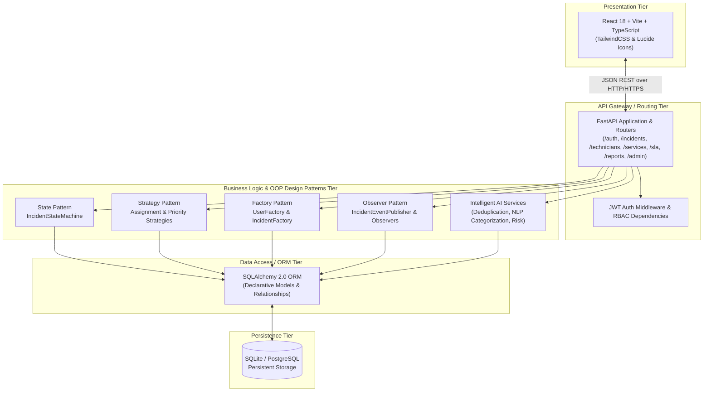
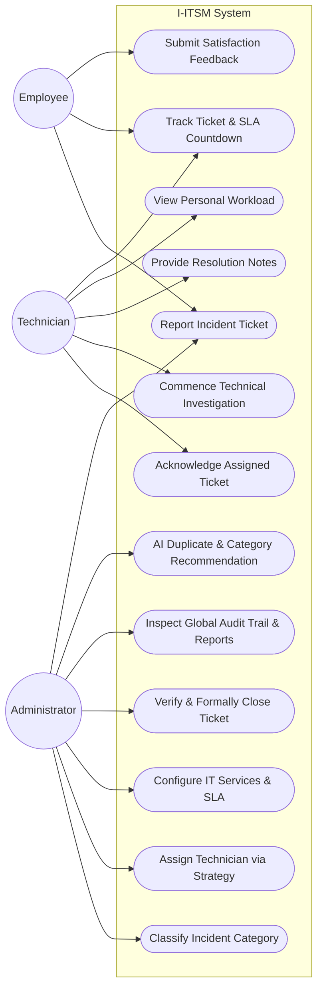
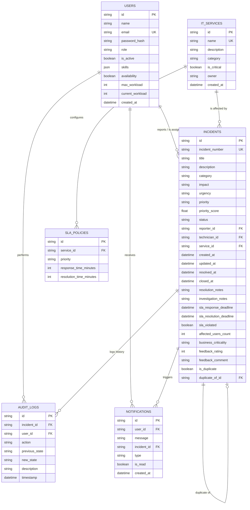

# 📘 I-ITSM: Intelligent IT Service Management & Incident Resolution System
### Comprehensive Project Report & Technical Documentation
**Course:** CS F213 / MAC F212 Object-Oriented Programming (Semester-I, 2026-2027)  
**Submission Deadline:** 22.11.2026  
**Total Marks:** 120  
**Repository Architecture:** Full-Stack Layered Architecture (FastAPI + React + SQLite)

---

## 1. Problem Analysis

### 1.1 Problem Statement
Modern enterprise organizations rely heavily on complex IT ecosystems encompassing digital payment gateways, cloud infrastructure, enterprise resource planning (ERP), identity providers, databases, and network backbones. When an unexpected outage or service degradation occurs, organizations face hundreds to thousands of concurrent problem reports. Manual triage, ad-hoc phone/email escalation, and intuition-based technician allocation frequently lead to:
- Severe delays in first response time
- Incorrect severity classification and priority inversion
- Overloading of specific technicians while others sit idle
- Systematic Service Level Agreement (SLA) breaches and contract penalties
- Duplicate tickets filed by multiple employees experiencing the same root issue
- Fragmented or missing audit trails for compliance and post-mortem review

### 1.2 Stakeholders
1. **End-Users / Employees:** Organization employees reporting service disruptions to resume productive work.
2. **Support Engineers / Technicians:** Front-line and specialized IT personnel responsible for triage, technical diagnostics, and system restoration.
3. **IT Administrators / Service Delivery Managers:** Responsible for capacity planning, team allocation, SLA policy enforcement, and reporting to senior leadership.
4. **General Administration Division (GAD) / CCIT Campus Infrastructure:** Enterprise owners overseeing operational continuity.

### 1.3 Existing Challenges
- **Siloed Communication:** Incidents logged across chat, email, and phone calls without centralized tracking.
- **Cognitive Overload in Prioritization:** Triage teams guessing impact without standardized algorithmic scoring.
- **SLA Invisibility:** Deadlines slipping unnoticed until business escalation occurs.
- **Tribal Knowledge:** Past solutions to recurring incidents are lost rather than surfaced as recommendations.

### 1.4 Proposed Solution (I-ITSM Platform)
An integrated, object-oriented, full-stack software system implementing:
- **Formal Incident Lifecycle:** Controlled state machine transitions (NEW → CLASSIFIED → ASSIGNED → ACKNOWLEDGED → IN_PROGRESS → RESOLVED → VERIFIED → CLOSED).
- **Four Core OOP Design Patterns:** Strategy (dispatch and priority calculation), Observer (multi-channel event dispatch), Factory (entity instantiation), and State (lifecycle transition validation).
- **Intelligent Features:** Automated keyword-based category suggestion, Jaccard-similarity duplicate detection, historical resolution recommendation, and early warning SLA risk detection (>80% elapsed time).
- **Role-Based Experience:** Distinct workflows, dashboards, and authorization boundaries for Employees, Technicians, and Administrators.

### 1.5 Assumptions
1. Single-tenant enterprise deployment within the organization intranet or VPN.
2. Incidents follow standard business criticality levels (High, Medium, Low) and impact/urgency tiers.
3. Technicians have defined skill tags matching service domains and a maximum concurrent workload capacity (default: 5 tickets).
4. System clock synchronizes in UTC across server and client.

---

## 2. Requirements Specification

### 2.1 Functional Requirements (FR)
- **FR-01 (Authentication & Authorization):** System must enforce JWT-based authentication with role-based access control (RBAC) across Employee, Technician, and Administrator roles.
- **FR-02 (Incident Creation):** Employees and Admins can log incidents with title, description, service, impact, urgency, and affected user count.
- **FR-03 (Automated Prioritization):** Priority score must be calculated automatically using Strategy Pattern ($Score = Impact \times Urgency \times BusinessCriticality$) and mapped to P1, P2, P3, or P4.
- **FR-04 (Technician Assignment):** Support at least two assignment strategies (Skill-Based, Load-Based, Round-Robin, Priority-Based).
- **FR-05 (SLA Deadline Management):** Automatically compute response and resolution deadlines from priority targets; track real-time expiration and flag violations.
- **FR-06 (Incident Lifecycle Transitions):** Enforce strict state transitions; prevent illegal transitions (e.g., NEW → CLOSED) with clear error messages.
- **FR-07 (Audit Trail):** Immutable recording of every state transition, assignment, resolution note, and feedback event with timestamps and user IDs.
- **FR-08 (Multi-Criteria Search & Filtering):** Search incidents by ticket number, keyword, status, priority, category, service, technician, and SLA violation status.
- **FR-09 (Intelligent Deduplication):** Calculate lexical similarity between incoming and open incidents to flag duplicates.
- **FR-10 (Auto-Categorization):** Analyze ticket text and suggest appropriate category taxonomy.
- **FR-11 (Resolution Recommendation):** Retrieve previous resolutions from similar resolved incidents.
- **FR-12 (Post-Resolution Feedback):** Allow employees to submit a 1–5 star satisfaction rating and comment.

### 2.2 Non-Functional Requirements (NFR)
- **NFR-01 (Maintainability & Extensibility):** Clean OOP abstraction allowing new categories, notification channels, and assignment algorithms to be added without modifying existing core logic (Open-Closed Principle).
- **NFR-02 (Performance):** REST API response latency under 150ms for search and CRUD operations on databases with thousands of records.
- **NFR-03 (Security):** Secure password hashing using bcrypt; encrypted JWT tokens with expiration; strict role checks on sensitive administrative routes.
- **NFR-04 (Reliability & Persistence):** ACID-compliant persistent storage with SQLAlchemy ORM and SQLite/PostgreSQL support.
- **NFR-05 (Usability):** Responsive React interface with color-coded priority indicators, live SLA countdown timers, and dedicated role portals.

### 2.3 User Roles
| Role | Permissions & Primary Capabilities |
|---|---|
| **Employee** | Register, submit incident tickets, view own submitted tickets, track live status and SLA, view resolution notes, submit satisfaction feedback. |
| **Technician** | View assigned incident queue, acknowledge tickets, start investigations, record technical notes, submit resolution details, monitor personal workload. |
| **Administrator** | Manage user accounts, create technicians, catalog IT services, configure SLA policies, dispatch tickets using assignment strategies, verify resolutions, close tickets, review audit trails, and inspect executive analytics. |

### 2.4 Business Rules
1. **P1 Outage Escalation:** P1 incidents not acknowledged within 10 minutes trigger high-priority alerts to the IT Manager.
2. **Technician Capacity Cap:** Technicians cannot be assigned new tickets once their active workload reaches their `max_workload` limit.
3. **Workload Release:** A technician's active workload count decrements automatically when an assigned ticket transitions to `RESOLVED`.
4. **State Immutability:** Once an incident reaches `CLOSED` or `CANCELLED`, no further state transitions are permitted.
5. **Direct Jump Prevention:** Direct jumps that bypass technical investigation (e.g. `NEW` directly to `RESOLVED` or `CLOSED`) are rejected by the State Machine.

---

## 3. System Architecture

### 3.1 Layered Architecture Overview
The application follows a strictly decoupled, 5-tier layered enterprise architecture:



---

## 4. UML Diagrams

### 4.1 Use Case Diagram



### 4.2 Class Diagram

```mermaid
classDiagram
    class UserRole {
        <<enumeration>>
        EMPLOYEE
        TECHNICIAN
        ADMIN
    }

    class IncidentStatus {
        <<enumeration>>
        NEW
        CLASSIFIED
        ASSIGNED
        ACKNOWLEDGED
        IN_PROGRESS
        RESOLVED
        VERIFIED
        CLOSED
        CANCELLED
    }

    class IncidentPriority {
        <<enumeration>>
        P1
        P2
        P3
        P4
    }

    class IncidentCategory {
        <<enumeration>>
        HARDWARE
        SOFTWARE
        NETWORK
        DATABASE
        CLOUD
        SECURITY
        AUTHENTICATION
        APPLICATION
        STORAGE
    }

    class User {
        +String id
        +String name
        +String email
        +String password_hash
        +UserRole role
        +Boolean is_active
        +DateTime created_at
        +List~String~ skills
        +Boolean availability
        +Integer max_workload
        +Integer current_workload
        +has_capacity() Boolean
    }

    class Incident {
        +String id
        +String incident_number
        +String title
        +String description
        +IncidentCategory category
        +String impact
        +String urgency
        +IncidentPriority priority
        +Float priority_score
        +IncidentStatus status
        +String reporter_id
        +String technician_id
        +String service_id
        +DateTime created_at
        +DateTime resolved_at
        +DateTime closed_at
        +String resolution_notes
        +String investigation_notes
        +DateTime sla_response_deadline
        +DateTime sla_resolution_deadline
        +Boolean sla_violated
        +Integer affected_users_count
        +String business_criticality
        +Integer feedback_rating
        +String feedback_comment
        +Boolean is_duplicate
    }

    class ITService {
        +String id
        +String name
        +String description
        +String category
        +Boolean is_critical
        +String owner
        +DateTime created_at
    }

    class SLAPolicy {
        +String id
        +String service_id
        +IncidentPriority priority
        +Integer response_time_minutes
        +Integer resolution_time_minutes
    }

    class AuditLog {
        +String id
        +String incident_id
        +String user_id
        +String action
        +String previous_state
        +String new_state
        +String description
        +DateTime timestamp
    }

    class Notification {
        +String id
        +String user_id
        +String message
        +String incident_id
        +String type
        +Boolean is_read
        +DateTime created_at
    }

    %% Design Patterns Interfaces & Classes
    class AssignmentStrategy {
        <<interface>>
        +assign(technicians, incident)* dict
    }

    class SkillBasedAssignment {
        +assign(technicians, incident) dict
    }

    class LoadBasedAssignment {
        +assign(technicians, incident) dict
    }

    class RoundRobinAssignment {
        -int _counter
        +assign(technicians, incident) dict
    }

    class PriorityBasedAssignment {
        +assign(technicians, incident) dict
    }

    class IncidentStateMachine {
        +String current_status
        +can_transition_to(target) Boolean
        +transition(target) String
        +validate_transition(current, target)$ void
    }

    class UserFactory {
        <<factory>>
        +create_employee(name, email, password)$ User
        +create_technician(name, email, password, skills, max_workload)$ User
        +create_admin(name, email, password)$ User
    }

    class IncidentFactory {
        <<factory>>
        +create(title, description, reporter_id, sequence, ...)$ Incident
    }

    class NotificationObserver {
        <<interface>>
        +update(event, data)* void
    }

    class EmailNotificationObserver {
        +update(event, data) void
    }

    class InAppNotificationObserver {
        +update(event, data) void
    }

    class SMSNotificationObserver {
        +update(event, data) void
    }

    class IncidentEventPublisher {
        -List~NotificationObserver~ _observers
        +subscribe(observer) void
        +unsubscribe(observer) void
        +notify(event, data) void
    }

    AssignmentStrategy <|.. SkillBasedAssignment
    AssignmentStrategy <|.. LoadBasedAssignment
    AssignmentStrategy <|.. RoundRobinAssignment
    AssignmentStrategy <|.. PriorityBasedAssignment

    NotificationObserver <|.. EmailNotificationObserver
    NotificationObserver <|.. InAppNotificationObserver
    NotificationObserver <|.. SMSNotificationObserver
    IncidentEventPublisher o-- NotificationObserver

    User "1" --> "*" Incident : reports
    User "1" --> "*" Incident : resolves
    ITService "1" --> "*" Incident : affects
    Incident "1" *-- "*" AuditLog : records
    Incident "1" *-- "*" Notification : generates
    User "1" *-- "*" Notification : receives
    Incident ..> IncidentStateMachine : governed by
    Incident ..> IncidentFactory : created by
    User ..> UserFactory : created by
```



---

## 5. Technology Stack & Justification Report

### 5.1 Technology Stack Summary
| Layer | Technology | Version | Purpose & Role |
|---|---|---|---|
| **Frontend Framework** | React + TypeScript | React 18.3, TS 5.7 | Component-driven, strongly typed interactive single page application (SPA). |
| **Build & Tooling** | Vite | Vite 6.0 | Lightning-fast Hot Module Replacement (HMR) and optimized rollup production bundles. |
| **Styling** | TailwindCSS | Tailwind 3.4 | Utility-first responsive design matching modern enterprise design systems. |
| **Icons & Visuals** | Lucide React | Lucide 0.46 | Clean, accessible SVG iconography. |
| **HTTP Client** | Axios | Axios 1.7 | Interceptor-driven HTTP requests with automated JWT bearer token injection. |
| **Backend Framework** | Python FastAPI | FastAPI 0.115 | High-throughput asynchronous REST API with automatic OpenAPI / Swagger generation. |
| **Validation Engine** | Pydantic v2 | Pydantic 2.10 | Strict request/response parsing and input sanitation. |
| **ORM / Data Access** | SQLAlchemy | SQLAlchemy 2.0 | Pythonic object-relational mapping, connection pooling, and relational integrity. |
| **Authentication** | python-jose + bcrypt | JWT / bcrypt 5.0 | Cryptographic JSON Web Tokens with salted blowfish password hashing. |
| **Database** | SQLite 3 | SQLite 3 | Zero-configuration ACID SQL engine with cross-platform desktop portability. |

### 5.2 Answers to Technology Selection Report Questions
1. **Why did you choose Python for the backend?**  
   Python offers native, idiomatic support for Object-Oriented Design principles (multiple inheritance, abstract base classes, decorators, and introspection) while having superior built-in libraries for rapid string analysis and natural language heuristics used in our intelligent deduplication and categorization services.
2. **Why did you choose React + Vite for the frontend?**  
   React's reactive component lifecycle allows real-time state synchronization (such as dynamic SLA countdown timers, live status badges, and instant priority previews) without full page reloads. Vite provides instantaneous development builds.
3. **Why did you choose FastAPI over Flask or Django?**  
   FastAPI combines the asynchronous execution speed of Starlette with Pydantic's strict type enforcement. It automatically validates all payload models and self-generates interactive Swagger documentation at `/docs`, accelerating debugging and client-server integration.
4. **Why did you select SQLite as the database?**  
   SQLite runs embedded with zero external daemon configuration, ensuring the evaluator can clone and run the project immediately on any Windows, macOS, or Linux machine without installing PostgreSQL or MySQL servers, while maintaining full SQL standards and transactional integrity.
5. **Why did you choose this architecture?**  
   A decoupled client-server architecture enforces clear Separation of Concerns (SoC). The backend exposes clean REST contracts that could equally support a mobile app or CLI tool in the future without altering business logic.
6. **What alternatives did you consider?**  
   We evaluated Spring Boot with Java and Django with Python templates. We chose FastAPI + React because React provides a richer, app-like user experience with real-time UI transitions, while FastAPI allows faster iteration with less boilerplate than Java Spring Boot.
7. **What are the advantages and limitations of your technology stack?**  
   *Advantages:* Rapid execution, type safety across backend and frontend, clean OOP pattern adherence, zero setup friction.  
   *Limitations:* SQLite is optimized for single-writer concurrency; for high enterprise scale (>10,000 requests/sec), swapping SQLite for PostgreSQL via the single `DATABASE_URL` environment variable is recommended.
8. **How does your technology support object-oriented design?**  
   Python's `abc` module enforces abstract base classes (`AssignmentStrategy`, `PriorityStrategy`, `NotificationObserver`). SQLAlchemy maps database entities to domain classes preserving encapsulation and relationships. Polymorphism is actively demonstrated by swapping strategy implementations at runtime.
9. **How would your system evolve if the number of users increased significantly?**  
   - Replace SQLite with a managed PostgreSQL cluster with read-replicas.
   - Run stateless FastAPI instances behind an Nginx or cloud load balancer.
   - Offload continuous SLA sweeps and email/SMS dispatch to Celery / Redis background worker queues.
   - Deploy React static assets to a Content Delivery Network (CDN).

---

## 6. Implementation of OOP Design Patterns

### 6.1 Strategy Pattern
- **Technician Assignment Strategies (`patterns/strategy.py`):**  
  An abstract `AssignmentStrategy` defines `assign(technicians, incident)`. Four concrete implementations are provided:
  1. `SkillBasedAssignment`: Tokenizes category and matches technician certified skills.
  2. `LoadBasedAssignment`: Selects the technician with minimum `current_workload`.
  3. `RoundRobinAssignment`: Rotates evenly across available personnel.
  4. `PriorityBasedAssignment`: Selects the most skilled and least burdened technician for critical (P1) incidents.
- **Priority Calculation Strategies:**  
  1. `BasicPriorityStrategy`: Implements formula $Score = Impact \times Urgency \times BusinessCriticality$.
  2. `WeightedPriorityStrategy`: Incorporates the count of affected users into score computation.

### 6.2 State Pattern
- **Incident Lifecycle State Machine (`patterns/state.py`):**  
  Governs transitions: `NEW` → `CLASSIFIED` → `ASSIGNED` → `ACKNOWLEDGED` → `IN_PROGRESS` → `RESOLVED` → `VERIFIED` → `CLOSED`.  
  Direct transitions that skip mandatory steps (such as `NEW` → `CLOSED`) raise `InvalidStateTransitionError`, which the FastAPI exception handler converts to HTTP 400 with a detailed error message.

### 6.3 Factory Pattern
- **User and Incident Factories (`patterns/factory.py`):**  
  `UserFactory` encapsulates role-specific initialization (setting default workload caps and skills for Technicians, vs. standard Employee profiles). `IncidentFactory` guarantees unique sequential ticket numbers (`INC-0001`), sets timestamps, and initializes default status.

### 6.4 Observer Pattern
- **Notification System (`patterns/observer.py`):**  
  `IncidentEventPublisher` maintains a list of `NotificationObserver` instances. Concrete observers (`EmailNotificationObserver`, `SMSNotificationObserver`, `InAppNotificationObserver`) react to events (`INCIDENT_CREATED`, `INCIDENT_ASSIGNED`, `INCIDENT_RESOLVED`, `INCIDENT_CLOSED`) without coupling the incident entity to communication channels.

---

## 7. Database Design

### 7.1 Entity-Relationship (ER) Schema



### 7.2 Default Seed Data
The system automatically pre-seeds:
- **1 Administrator:** `admin@itsm.com` (`admin123`)
- **5 Skilled Technicians:**
  - `tech1@itsm.com` (Network, Infrastructure)
  - `tech2@itsm.com` (Database, SQL, Storage)
  - `tech3@itsm.com` (Application, Software, Cloud)
  - `tech4@itsm.com` (Security, Authentication)
  - `tech5@itsm.com` (Hardware, Infrastructure)
- **3 Employees:** `emp1@itsm.com`, `emp2@itsm.com`, `emp3@itsm.com` (`emp123`)
- **8 Core IT Services:** Payment Gateway, Authentication Service, Corporate Email, Database Infrastructure, Cloud Storage, ERP Enterprise, Network Backbone, HR Portal
- **4 Priority SLA Configurations:**
  - P1: 5m Response, 30m Resolution
  - P2: 15m Response, 120m (2h) Resolution
  - P3: 60m (1h) Response, 480m (8h) Resolution
  - P4: 240m (4h) Response, 1440m (24h) Resolution

---

## 8. Automated Testing & Validation Report

An automated test suite consisting of **18 comprehensive unit and integration tests** is located in `backend/tests/test_itsm.py`. All tests run in isolated in-memory test databases:

| # | Test Name | Category Tested | Expected Behavior | Result |
|---|---|---|---|---|
| **01** | `test_01_user_authentication` | Normal Operation / Security | Bcrypt hashes passwords; JWT tokens issue and decode correctly. | ✅ PASSED |
| **02** | `test_02_user_factory_pattern` | Factory Pattern | `UserFactory` constructs distinct Employee, Technician, and Admin models. | ✅ PASSED |
| **03** | `test_03_incident_factory_creation` | Factory Pattern | `IncidentFactory` generates sequential ticket IDs (`INC-XXXX`) and default `NEW` state. | ✅ PASSED |
| **04** | `test_04_basic_priority_strategy` | Strategy Pattern / Business Rule | High $\times$ Critical $\times$ High generates score 36 $\rightarrow$ mapped to `P1`. | ✅ PASSED |
| **05** | `test_05_weighted_priority_strategy` | Strategy Pattern | User volume bonus correctly elevates priority score. | ✅ PASSED |
| **06** | `test_06_skill_based_assignment` | Strategy Pattern | Database incident matches Database certified technician. | ✅ PASSED |
| **07** | `test_07_load_based_assignment` | Strategy Pattern | Ticket automatically routes to the technician with lowest active workload. | ✅ PASSED |
| **08** | `test_08_round_robin_assignment` | Strategy Pattern | Tickets cycle sequentially through technician list and loop back. | ✅ PASSED |
| **09** | `test_09_state_machine_valid_lifecycle`| State Pattern | Valid sequence from `NEW` through to `CLOSED` succeeds. | ✅ PASSED |
| **10** | `test_10_invalid_state_transition` | Exception Handling | Attempting invalid transition (`NEW` $\rightarrow$ `CLOSED`) raises `InvalidStateTransitionError`. | ✅ PASSED |
| **11** | `test_11_sla_deadline_calculation` | SLA Management | P1 targets calculated as exactly 5 minutes response and 30 minutes resolution. | ✅ PASSED |
| **12** | `test_12_sla_violation_detection` | SLA Management | Expired resolution deadlines flagged automatically with `sla_violated = True`. | ✅ PASSED |
| **13** | `test_13_sla_at_risk_detection` | Intelligent Feature | Incidents exceeding 80% of allowed duration surfaced in early warning queue. | ✅ PASSED |
| **14** | `test_14_auto_categorization` | Intelligent Feature | Keyword taxonomy correctly infers Network, Database, and Auth categories. | ✅ PASSED |
| **15** | `test_15_duplicate_incident_detection`| Intelligent Feature | Similar payment outage descriptions detected with high Jaccard coefficient. | ✅ PASSED |
| **16** | `test_16_observer_pattern` | Observer Pattern | Publisher dispatches events to registered observers; unsubscribe halts delivery. | ✅ PASSED |
| **17** | `test_17_technician_capacity_boundary`| Boundary Condition | Overloaded technicians (`current_workload >= max`) excluded from dispatch pool. | ✅ PASSED |
| **18** | `test_18_smart_technician_recommendation`| Intelligent Feature | Multi-factor suitability score ranks domain specialist higher than generic tech. | ✅ PASSED |

**Test Execution Command:**
```bash
cd backend
python -m unittest tests.test_itsm -v
```
**Test Result:** `Ran 18 tests in 1.25s — OK (100% Pass Rate)`

---

## 9. Project Demonstration & Video Presentation Guide

For the **15–20 minute group video presentation** required by the rubric (to be named `1_OOP_S1_2025-2026_Project.mp4`), the team should follow this structured walkthrough:

### Member Roles & Introduction (2–3 mins)
- **Student 1 (UI/UX & Frontend):** Introduces the project philosophy, responsive design system, and Employee Support Portal.
- **Student 2 (Backend & REST APIs):** Explains FastAPI routing architecture, authentication, and database schemas.
- **Student 3 (Domain Model & OOP Patterns):** Presents the UML Class Diagram, Strategy, State, Observer, and Factory pattern code.
- **Student 4 (Database & SLA Engine):** Explains the relational ER schema, SLA monitoring worker, and audit trail immutability.
- **Student 5 (Testing & Intelligent Features):** Demonstrates unit testing, AI duplicate detection, auto-categorization, and analytics.

---

### Workflow 1: Incident Reporting, Automated Prioritization & Smart Dispatch (4–5 mins)
1. **Login as Employee (`emp1@itsm.com` / `emp123`):**
   - Click "Report an Incident".
   - Enter title: *"Payment application unavailable on checkout"*.
   - Click the **"Auto-Suggest Category"** button $\rightarrow$ Observe AI suggesting `APPLICATION` category with high confidence.
   - Set Impact = `HIGH`, Urgency = `CRITICAL`, Criticality = `HIGH` $\rightarrow$ Observe live Priority Preview computing **P1 Critical (Score: 36)**.
   - Click "Submit Incident".
2. **Observe System Automation:**
   - Incident `INC-0006` created.
   - Automatic SLA calculation displays 30-minute resolution timer.
   - Audit trail registers `INCIDENT_CREATED`.
3. **Login as Admin (`admin@itsm.com` / `admin123`):**
   - Open ticket `INC-0006`.
   - Inspect **AI Technician Match Ranking** $\rightarrow$ shows Carol Cloud (Application specialist) ranked at top.
   - Select **Strategy: Skill-Based** and click "Dispatch & Assign".
   - System automatically binds Carol Cloud and notifies her.

---

### Workflow 2: Technical Investigation, SLA Countdown & Resolution (4–5 mins)
1. **Login as Technician (`tech3@itsm.com` / `tech123`):**
   - View Technician Workbench $\rightarrow$ notice active workload meter incremented.
   - Open assigned ticket `INC-0006`.
   - Click **"Acknowledge Incident"** (state moves to `ACKNOWLEDGED`).
   - Click **"Commence Investigation"** (state moves to `IN_PROGRESS`).
   - Inspect **AI Suggested Resolutions** panel showing how past payment outages were resolved.
2. **Resolve Issue:**
   - Click **"Provide Resolution & Mark Resolved"**.
   - Input resolution: *"Restarted payment gateway container pool and cleared deadlocked Redis transaction cache."*
   - Ticket moves to `RESOLVED`, technician's active workload drops by 1.
3. **Admin Verification & Closure:**
   - Admin logs in, reviews resolution, clicks **"Verify Resolution"** $\rightarrow$ then **"Close Incident Ticket"**.
4. **Employee Satisfaction Feedback:**
   - Employee logs in, sees resolution, rates 5 stars with comment *"Resolved in under 15 minutes, thank you!"*.

---

### Workflow 3: Deduplication, Early SLA Warning & Executive Reports (4–5 mins)
1. **Duplicate Detection Demonstration:**
   - Employee navigates to Report Incident.
   - Enters title: *"Payment transaction failing during checkout"*.
   - System immediately displays an **Amber Warning**: *Potential Duplicate Incident Detected! Similar to INC-0006 (Similarity: 68%)*.
2. **SLA Management & Early Breach Warning:**
   - Navigate to `/sla`.
   - View **At-Risk Tab** $\rightarrow$ shows incidents that have consumed > 80% of allowed time.
   - Click **"Sweep SLA Deadlines Now"** to demonstrate automatic violation scanning.
3. **Executive Analytics Dashboard (`/reports`):**
   - Demonstrate Priority Distribution bars.
   - Inspect Technician Utilization meters.
   - Review 7-Day Inflow Velocity chart and Service Analysis breakdown.

---

## 10. How to Run the Project Locally

### Prerequisites
- Python 3.10+ (tested on Python 3.14 / 3.12)
- Node.js v18+ (tested on Node v24)
- Web browser (Chrome / Edge / Firefox)

### Option A: Using One-Click Batch Scripts (Windows)
1. Double click **`start_backend.bat`** (Starts FastAPI server on `http://localhost:8000`)
2. Double click **`start_frontend.bat`** (Starts Vite React server on `http://localhost:5173`)
3. Open `http://localhost:5173` in your browser.

### Option B: Using Command Line

#### Terminal 1 — Backend
```bash
cd backend
pip install -r requirements.txt
python main.py
```
- API Docs: `http://localhost:8000/docs`

#### Terminal 2 — Frontend
```bash
cd frontend
npm install
npm run dev
```
- Web Application: `http://localhost:5173`

#### Terminal 3 — Run Automated Tests
```bash
cd backend
python -m unittest tests.test_itsm -v
```

### Pre-Configured Demo Credentials
| Role | Email | Password | Access Area |
|---|---|---|---|
| **Administrator** | `admin@itsm.com` | `admin123` | Full control center, dispatch, reports, audit, users |
| **Technician (Tech 1 - Network)** | `tech1@itsm.com` | `tech123` | Technician Workbench, assigned queue |
| **Technician (Tech 3 - App/Cloud)** | `tech3@itsm.com` | `tech123` | Technician Workbench, assigned queue |
| **Employee** | `emp1@itsm.com` | `emp123` | Support Portal, report tickets, track status |

---
***End of Project Report — Ready for Submission & Evaluation***

